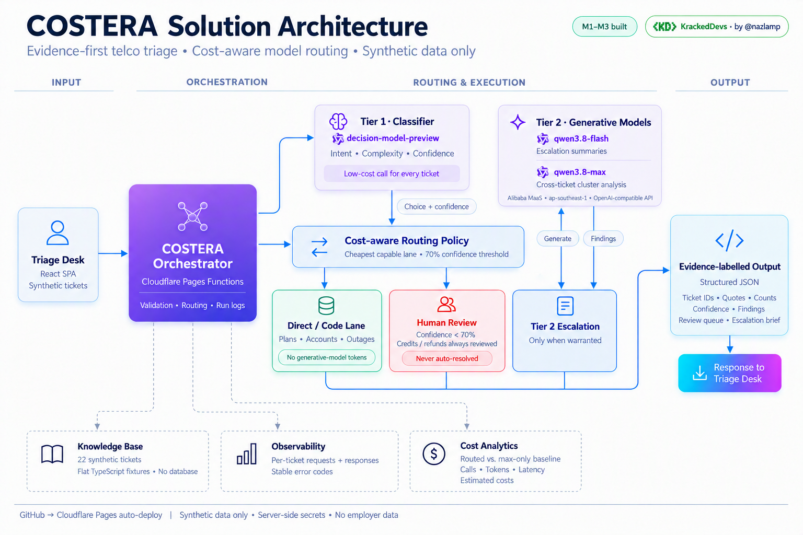

# COSTERA — Triage Desk

Kracked Devs bounty entry: **Build for Better Connectivity**.

A triage desk for a support agent at **ZephyrTel, a fictional telco**. It turns a batch of
scattered synthetic tickets into evidenced recurring patterns and a draft escalation brief,
routing each step to the cheapest lane that can do it — and handing off to a human when it
isn't sure.

**All data is synthetic.** Tickets, customers, plans and outages are generated from scratch.
Patterns are observations in synthetic data, not verified network truth. No real provider
names, branding, customer data or employer systems are used.

## Flow (M1 walking skeleton)

1. Agent loads the synthetic ticket batch (22 tickets).
2. Tier 1 classifier (`decision-model-preview`) classifies intent + complexity with probabilities.
3. Routing:
   - **Direct / code lane** — deterministic lookup against a synthetic knowledge base
     (plans, accounts, known outages, procedures). No generation call.
   - **Human review** — confidence below 70%, or anything touching credits/refunds.
   - **Tier 2 candidate** — complex with no deterministic answer (escalation itself is M2).
4. Output: recurring patterns with evidence (ticket IDs, quoted lines, counts, confidence),
   a per-ticket routing table, and a deterministically assembled draft escalation brief.

M2 adds the escalation lanes: Tier 2 light (`qwen3.8-flash`) writes plain-language summaries
for the escalation set (candidates + human review); Tier 2 heavy (`qwen3.8-max`) analyses
cross-ticket clusters **only when warranted** (high-volume, or containing unsure/candidate
tickets). Human-review handoffs carry the summaries and analysis. All Tier 2 output is
labelled model-generated in the UI, the brief and the run logs.

M3 adds a merged "Models & cost routing" section: one card per lane with its tier, model
name, role, and (after a run) calls/tokens/latency plus estimated cost. Below the cards, a
plain-language comparison shows routed cost vs an all-Max baseline as two bars, with the
savings percentage. Rates are fixed assumptions listed in a footnote; every figure is
labelled an estimate, not billing truth.

## Architecture



- Static React 19 + TypeScript + Vite + Tailwind frontend (`src/`), built to `dist/`.
- **Cloudflare Pages Functions** (`functions/api/[[path]].ts`) expose `/api/health`,
  `/api/batch`, `/api/triage`, `/api/credentials`. The runtime-agnostic triage core lives in `server/`.
- **No server-side secrets anywhere.** Model access comes from the reviewer's own session
  credentials entered in Settings; they are used server-side for that single request and never
  appear in client code, this repo, browser storage or logs.
- No database: synthetic tickets and knowledge base are flat TypeScript modules.

> Diagram note: the "Server-side secrets" caption in the picture predates the move to reviewer
> session keys. Nothing is read from server secrets any more — see Configuration below.

## Configuration

There is nothing to configure on the server. **Settings → "Bring your own API access"** is the
only source of model credentials. One key and base URL can be shared across all three tiers, or
overridden per tier, and each tier has its own connection **Test** button:

| Field | Purpose |
| --- | --- |
| API key | Your MaaS / provider key — memory-only, sent with each run, never stored or logged |
| Base URL | OpenAI-compatible base URL incl. `/compatible-mode/v1/`, public HTTPS on the default port |
| Model per tier | Tier 1 classifier, Tier 2 light, Tier 2 heavy (dropdown of popular models, or a custom ID) |

- Without session credentials `/api/triage` returns `service_not_configured` — it never fakes
  live results. The Functions entry point, the dev servers and the checks all pass an **empty**
  environment reader, so no deployment of this app can spend anyone else's key or quota.
- There is deliberately no `.env` / `.env.example` / `.dev.vars` step; earlier builds read owner
  secrets that way and that path has been removed. `.gitignore` keeps the `.env*` rules purely as
  defense in depth. Never commit or paste real values.

Session values are **memory-only**: a refresh clears them and they must be re-entered. They are
sent to this site's server over HTTPS solely for that run, never stored, never logged, never
written to browser storage, and never used for a tier other than the one they belong to
(per-tier overrides win outright, with no fallback to any other key). Session endpoints must be
public HTTPS URLs on the default port (loopback/private/link-local hosts are rejected). Run logs
record only `keySource` (`session` for reviewer keys, `env` only for a hypothetical
server-secret deployment), never the key or hostname. **Run triage opens a setup checklist**
until all three tiers are configured and Test-confirmed, guiding the reviewer to Settings;
fixture mode (local development) is the only run that skips that step.

Each tier also accepts a **model choice from a curated popular-model dropdown** (Qwen, DeepSeek,
OpenAI, Anthropic, Moonshot/Kimi; plus a custom-ID escape hatch). Qwen groups list first and the
verified Qwen trio is marked "recommended" in every dropdown and tier header. Tier 1 has a
**classifier type dropdown**: the verified decision contract (`POST {base}/systemone`,
`decision-model-preview` or `jeff` / JEFF where the endpoint exposes it) or any chat model as
classifier via `POST {base}/chat/completions`. The classifier choice never applies to the Tier 2
lists. The chat engine uses a strict JSON prompt; its confidence is
self-reported (no calibrated probabilities), and the 70% unsure floor and refund rules still apply.

Cost figures follow the **models actually used per run** (assumed per-model rates), so a reviewer
can point all three tiers at one flagship model, run, then restore a tiered mix and run again:
Cost analytics prices each run separately and the difference is what tiering saves.

**Testing disclaimer:** the full end-to-end workflow has only been verified with the Qwen family
(`decision-model-preview`, `qwen3.8-flash`, `qwen3.8-max`). Other providers and models are
contract-compatible but untested end-to-end; the Settings page carries the same disclaimer plus
the recommended 100%-verified setup (decision contract for Tier 1, flash/max for Tier 2, a Qwen
MaaS OpenAI-compatible base URL ending in `/compatible-mode/v1`, one shared key) with a one-click
"Apply verified model setup" button that sets the three model selections.

The decision-model **response** parsing follows the verified shape (`answers.<field>.choice /
.confidence / .probabilities`). The request contract is owner-verified: `POST {base}/systemone`
with `{ model, state, questions }` (choice-type questions in M1), built in
`server/decision.ts → buildDecisionRequest()`. Flash/max use `{base}/chat/completions`.

## Local development

```sh
npm ci
node dev/node-function-local.mjs   # fixture Function server on 127.0.0.1:8000 (dev only)
npm run dev                        # Vite on 127.0.0.1:5173, proxies /api
```

Fixture mode simulates Tier 1 responses and is clearly labelled in the UI. The fixture
classifier lives in `dev/` and is never deployed.

Real Workers runtime check (needs `npm run build` first; no secrets to supply):

```sh
npm run dev:cf                     # wrangler pages dev on 127.0.0.1:8001
```

Live local run against the real API — same code path as the deployment, no env files:

```sh
node dev/node-live-local.mjs       # real Tier 1/2 on :8000 (stop the fixture server first)
```

The server reads **no** environment variables, so health reports no server key and every real
call uses the credentials you type into Settings — exactly like the public site. Provider
lock-in is likewise gone: any OpenAI-compatible endpoint and model ID works, with the Qwen trio
as the verified default.

`dev/probe-contract.mjs` is a throwaway request-contract probe, not part of the app; it takes its
two values as arguments (`node dev/probe-contract.mjs <apiKey> <baseUrl>`) so nothing is read from
a file. Command-line arguments land in your shell history, so use a private shell for it.

Checks:

```sh
node dev/node-check.mjs            # credential-free handler checks (Node)
npm run build                      # type-check + static build
```

## Run logs

Every triage run produces an audit record: run ID, timestamp, mode, stats, and a per-ticket
trace with the exact request body sent to the decision model and its raw response, plus the
routing outcome. Logs never contain headers, the API key, or the endpoint hostname.

- Local dev servers write one pretty JSON file per run to `logs/` (gitignored).
- Deployed Pages Functions emit one structured JSON line per run to the console
  (visible in Cloudflare Pages logs).
- `POST /api/triage` with `{"includeTrace": true}` also returns the trace in the response.

## State and persistence

**No database, by design.** M1–M3 is a stateless demo: the ticket batch and knowledge base are
flat TypeScript modules, nothing is written server-side except run logs, and there is no store
for runs, patterns, briefs or marks. So **reloading the page resets the desk** — the last run,
findings, escalation brief, brief marks, run history and cost readout all disappear, and the
reviewer re-enters API access in Settings, Test-confirms each tier and runs triage again.

Where each value lives:

| Value | Location | Survives refresh |
| --- | --- | --- |
| Theme choice | `localStorage` (`costera.theme`) | Yes |
| Session API keys, endpoints, model choices, brief marks | Page memory only | No — deliberately |
| Run result, patterns, brief, history, cost figures | Page memory only | No |
| Run logs (stats + per-ticket request/response trace) | `logs/*.json` locally; Pages console when deployed | Yes — the audit trail |

Session credentials are never persisted anywhere by choice: keeping them out of storage is what
makes "your key, your quota, one request at a time" true. Only non-secret state (the last run and
its stats) would move to a durable store — Cloudflare D1 or KV keyed by batch, with the run log
already providing the same records server-side. That is outside the current milestone, and the
UI states the reset behaviour on the banner, Settings and Run history so nobody loses work
without knowing.

## Deployment

GitHub repo → **Cloudflare Pages auto-deploy**. Build command `npm run build`, output
directory `dist`. Pages serves the static frontend and the Functions at `/api/*`, and
provides a public `*.pages.dev` URL. Starter attribution: `PROVENANCE.md`.